# TryHackMe: Logs Fundamentals

> **Track:** Cyber Security 101 → Defensive Security
> **Difficulty:** Easy · **Time:** ~45 min
> **Focus:** What logs are, the main log types, and how to investigate with them on both Windows (Event Viewer) and Linux (`grep`)

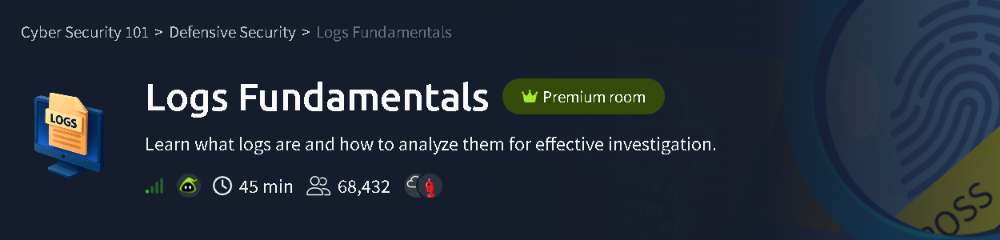

---

## Summary

Logs are the primary evidence trail on any system. This room explains what logs are and which kinds exist, then has you investigate two real log sources:

| Part | Tool | What I investigated |
|---|---|---|
| Windows | Event Viewer (Security log) | A suspicious user account: when it was created, enabled and given a password |
| Linux | Terminal + `grep` on a web server `access.log` | Who requested `/contact`, and what the last `POST` looked like |

---

## Step 1: Why Logs Matter

**Core idea:** Most traces of an attack on a digital system are left in logs, which is why analysts, SOC teams and incident responders start there.

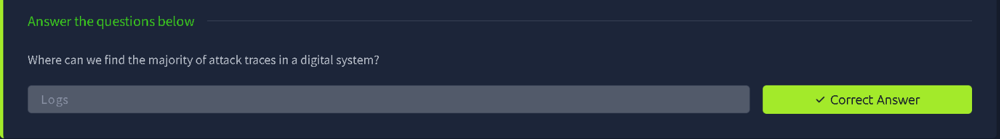

**Takeaway:** If something happened on a system, a log probably recorded it. Logs are where investigation begins.

---

## Step 2: Log Types

Logs are grouped by what they record. Two groups the room tests:

- **Network logs:** incoming and outgoing network traffic (firewalls, proxies, IDS/IPS).
- **Security logs:** authentication and authorization events (logins, privilege changes, account management).

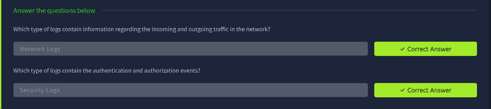

**Takeaway:** Knowing which log type holds which evidence tells you where to look first. Suspicious logins point to security logs, odd traffic points to network logs.

---

## Step 3: Windows Investigation with Event Viewer

The room provides a Windows machine. The goal is to find out about a suspicious account using the **Security** log.

### 3.1 Open the Security log

1. Open **Event Viewer**.
2. Expand **Windows Logs** and select **Security**.
3. The log holds over a thousand events, so scrolling is hopeless. Filter for **Event ID 4720** (*A user account was created*), which is the event recorded whenever a new account is made.

### 3.2 Find the newest created account

Opening the latest 4720 event and switching to the **Details** tab shows the **EventData** section:

- **TargetUserName** is the account that was created.
- **SubjectUserName** is the account that created it (here, `Administrator`).

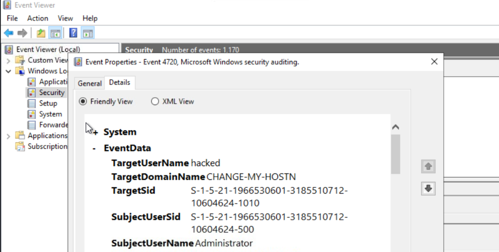

The newly created account's name is the answer to the first question.

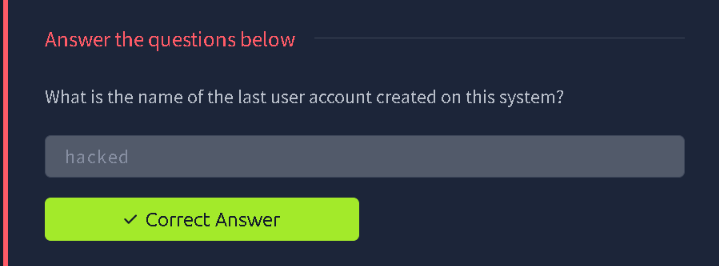

> **Why this matters:** Attackers often create a new local account as a persistence mechanism. Event 4720 combined with an unfamiliar name, created by `Administrator`, is a classic red flag.

### 3.3 Read the timestamp

The event's **General** tab shows when it was logged, plus the source, event ID, task category (*User Account Management*) and the computer name.

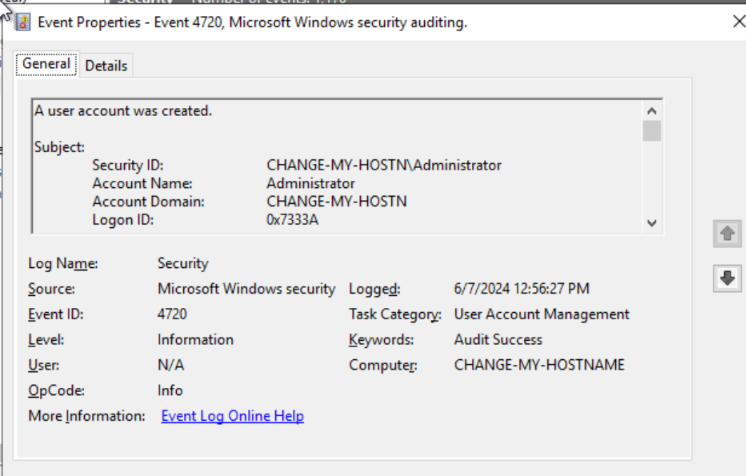

From the **Logged** field, the account activity happened on **6/7/2024** (format M/D/YYYY, as the room asks).

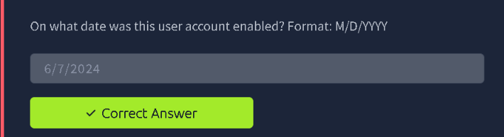

### 3.4 Check for a password reset

Account creation is only part of the story. I checked the same log for a password-reset event on the same account, and it confirmed the account **did** have its password set as well.

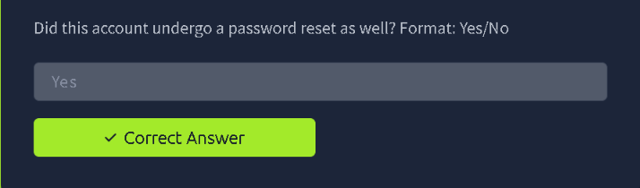

> **Reference:** Related Security events worth knowing are **4720** (account created), **4722** (account enabled), **4724** (password reset attempt) and **4738** (account changed). Together they let you rebuild the full lifecycle of an account.

---

## Step 4: Linux Investigation with `grep`

The second half moves to a Linux terminal and a web server access log.

### 4.1 Move to the logs folder and search

```bash
cd /root/Rooms/logs
grep "/contact" access.log
```

- `cd /root/Rooms/logs` moves to the folder holding the room's log files.
- `grep "/contact" access.log` prints only the lines that mention `/contact`, cutting a large log down to what matters.

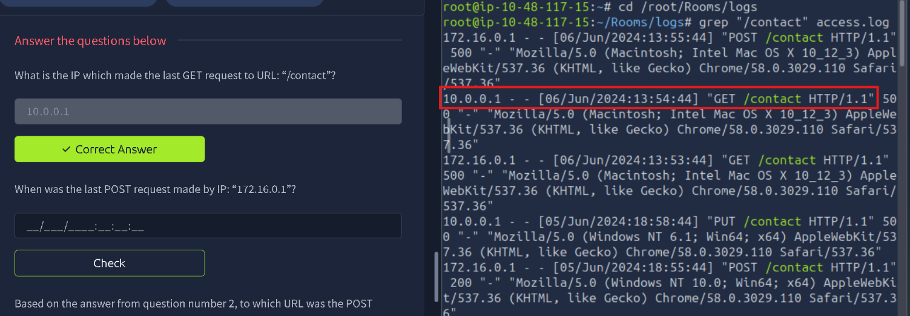

### 4.2 Read the log entries

Each Apache-style line is structured as:

```
<client IP> - - [<timestamp>] "<METHOD> <URL> <HTTP version>" <status> "-" "<user agent>"
```

In this output the newest entries appear first, so the first match for a given filter is the most recent.

**Question 1: Which IP made the last `GET` request to `/contact`?**
The highlighted line shows the `GET /contact` request from `10.0.0.1` at `06/Jun/2024:13:54:44`.

**Question 2: When was the last `POST` request made by `172.16.0.1`?**
The top line of the output is the `POST /contact` from `172.16.0.1` at `06/Jun/2024:13:55:44`.

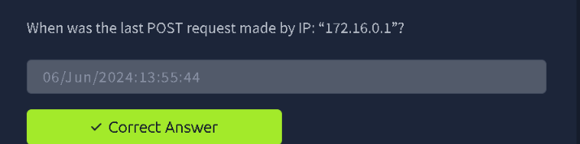

**Question 3: Which URL was that `POST` made to?**
It's the same entry, so the URL is `/contact`.

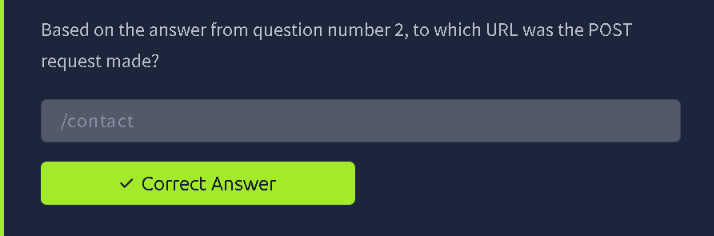

> **Tip:** To narrow things further, combine filters with a pipe, for example `grep "/contact" access.log | grep "POST"`, or use `grep -n` to include line numbers.

---

## Note on the Flag

This room's practical questions are answered directly in the question fields and **there is no separate flag to capture**, so nothing needed redacting. Work through the Event Viewer and `grep` steps yourself to get the answers.

---

## Key Takeaways

1. **Logs are the first place to look.** Most attack traces live there.
2. **Pick the right log type.** Security logs for authentication and accounts, network logs for traffic.
3. **Filter by Event ID** in Windows Event Viewer instead of scrolling (4720 for account creation).
4. **`grep` is a fast first pass** on Linux logs, and understanding the log line format makes the results easy to read.
5. **Timestamps and IPs** let you build a timeline of who did what, and when.

## Skills Practised

`Log Analysis` · `Windows Event Viewer` · `Event ID 4720` · `Account Persistence Detection` · `Linux CLI` · `grep` · `Web Server Access Logs`

---

*Room: [Logs Fundamentals](https://tryhackme.com/room/logsfundamentals) on TryHackMe.*
